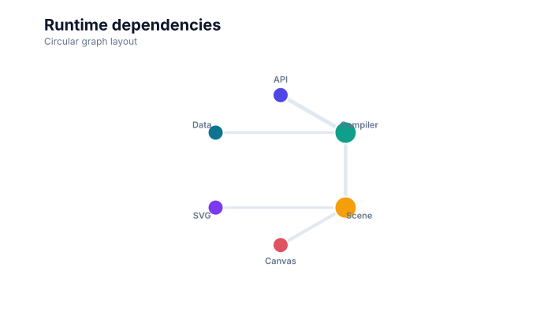
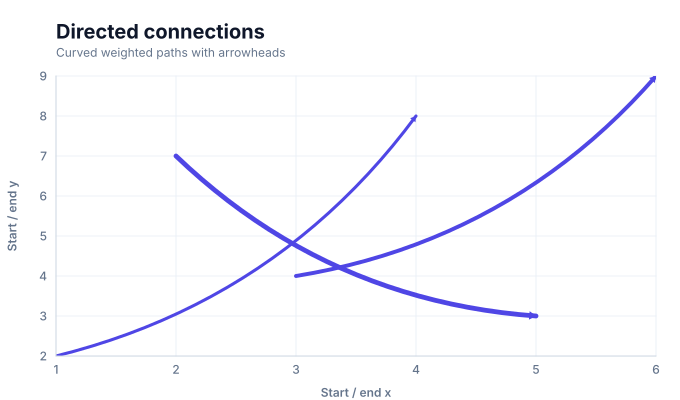
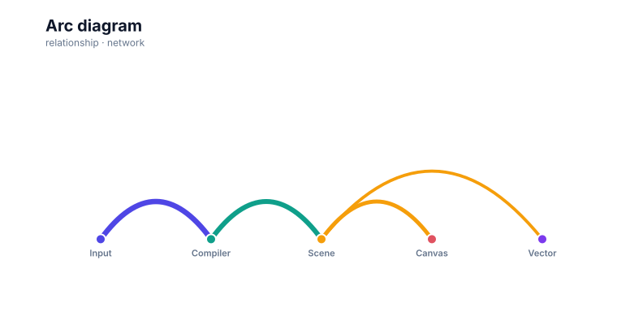
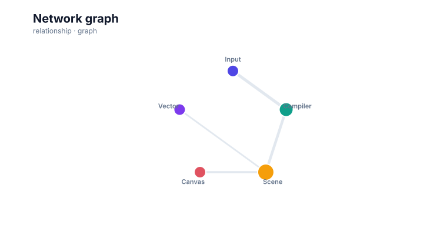

# Network chart

<!-- FAMILY_PRESETS_START -->

## Integrated presets

This is the single manual for the `network` family. Its canonical Quick API is `network()` from `graflume/complete`, and its representative portable mark is `graph`. The compatible names below remain callable, but they are modes or data-meaning presets rather than separate chart families.

| Compatible name                         | Quick API        | Mode            | Portable mark | Functional difference                                     |
| --------------------------------------- | ---------------- | --------------- | ------------- | --------------------------------------------------------- |
| [Graph chart](#variant-graph)           | `graph()`        | `node-link`     | `graph`       | Uses the deterministic node-link layout.                  |
| [Connection lines](#variant-lines)      | `lines()`        | `connections`   | `lines`       | Shows direct source-to-target connection paths.           |
| [Arc diagram](#variant-arc-diagram)     | `arcDiagram()`   | `arc-diagram`   | `arc-diagram` | Places nodes on one baseline and draws arcs between them. |
| [Network graph](#variant-network-graph) | `networkGraph()` | `network-graph` | `graph`       | Keeps the legacy network graph name for node-link mode.   |

All presets reuse the same validation, normalization, scale, compiler, renderer-neutral Scene, interaction, accessibility, and serialization contracts. Direction, curve, layout, glyph, depth, financial-body, and indicator choices stay in function-free fields or options instead of selecting a second rendering engine. The remaining manually maintained sections describe the canonical/default presentation unless a preset row above states a different behavior.

## Visual gallery

Every image below is generated from the current compiled Scene rather than drawn by hand. Select a name to jump to its data fields and implementation.

|                                                                                                                                                |                                                                                                                                                          |
| ---------------------------------------------------------------------------------------------------------------------------------------------- | -------------------------------------------------------------------------------------------------------------------------------------------------------- |
| **[Graph chart](#variant-graph)**<br>[](../assets/charts/graph.svg)                   | **[Connection lines](#variant-lines)**<br>[](../assets/charts/lines.svg)                   |
| **[Arc diagram](#variant-arc-diagram)**<br>[](../assets/charts/arc-diagram.svg) | **[Network graph](#variant-network-graph)**<br>[](../assets/charts/network-graph.svg) |

## Type-by-type implementation

The snippets are minimal runnable examples. Change `#chart` to the target element and expand the inline rows with your data. Each example opts into Graflume's safe text-only tooltip with a chart-specific title and ordered fields; number and date formatting follows the declared `locale`. This family keeps `trigger: "mark"`, so the pointer must hit rendered datum geometry. Pointer tooltip triggers remain a convenience; opt into `accessibility.table` and `accessibility.navigation` for the bounded native table and keyboard mark traversal, or provide a larger domain-specific table. The Quick API applies the preset defaults while keeping the resulting specification function-free and serializable.

Every family can opt into the Canvas [inspection viewport, fullscreen, reset, and PNG controls](./interactions.md). Inspection magnifies and translates the complete already-rendered chart, including its title and axes; it is not data-domain or GIS zoom. Generated examples intentionally leave playback off. Add discrete playback only after selecting a meaningful frame field and reviewing the family-specific capability table.

Every family also accepts the shared portable [legend, highlight, selection, and callout contract](./interactions.md#legends-highlights-selection-and-callouts). Automatic legend semantics follow the compiled mark and palette where they are unambiguous; use explicit function-free items for a domain-specific series or category legend. Static datum/layer/range highlights and text-only top-level callouts remain available even when a family has no Cartesian point geometry.

<a id="variant-graph"></a>

### Graph chart

Use this preset when entities and their connections are more important than a Cartesian axis. Uses the deterministic node-link layout.

- **Quick API:** `graph()`
- **Mode:** `node-link`
- **Portable mark:** `graph`
- **Required example fields:** `source`, `value`, `target`

```js
import { graph } from 'graflume/complete';

const data = [
  {
    source: 'Collected',
    value: 86,
    target: 'Validated',
  },
  {
    source: 'Collected',
    value: 14,
    target: 'Review queue',
  },
  {
    source: 'Validated',
    value: 58,
    target: 'Aggregated',
  },
  {
    source: 'Validated',
    value: 28,
    target: 'Exploration',
  },
];

graph('#chart', data, {
  x: {
    field: 'source',
    type: 'ordinal',
    title: 'Workflow node',
  },
  y: {
    field: 'value',
    type: 'quantitative',
    title: 'Interactions',
  },
  title: {
    text: 'Graph chart',
    subtitle: 'network family · node-link mode',
  },
  accessibility: {
    label: 'Graph chart: Product workflows reveal the strongest paths and the bridge between teams',
    description:
      'Product workflows reveal the strongest paths and the bridge between teams. The example uses curated, deterministic data and exposes its exact values in a semantic table.',
  },
  axes: {
    x: false,
    y: false,
  },
  mark: {
    fields: {
      target: 'target',
      value: 'value',
    },
  },
  locale: 'en-US',
  interaction: {
    tooltip: {
      title: 'Graph chart',
      fields: [
        {
          field: 'kind',
          label: 'Target',
          format: 'auto',
        },
        {
          field: 'node',
          label: 'Node',
          format: 'auto',
        },
        {
          field: 'degree',
          label: 'Connections',
          format: 'integer',
        },
        {
          field: 'total',
          label: 'Connected weight',
          format: 'number',
        },
        {
          field: 'source',
          label: 'From',
          format: 'auto',
        },
        {
          field: 'target',
          label: 'To',
          format: 'auto',
        },
        {
          field: 'value',
          label: 'Weight',
          format: 'number',
        },
      ],
      trigger: 'mark',
    },
  },
});
```

<a id="variant-lines"></a>

### Connection lines

Use this preset when entities and their connections are more important than a Cartesian axis. Shows direct source-to-target connection paths.

- **Quick API:** `lines()`
- **Mode:** `connections`
- **Portable mark:** `lines`
- **Required example fields:** `source`, `value`, `target`

```js
import { lines } from 'graflume/complete';

const data = [
  {
    source: 'Collected',
    value: 86,
    target: 'Validated',
  },
  {
    source: 'Collected',
    value: 14,
    target: 'Review queue',
  },
  {
    source: 'Validated',
    value: 58,
    target: 'Aggregated',
  },
  {
    source: 'Validated',
    value: 28,
    target: 'Exploration',
  },
];

lines('#chart', data, {
  x: {
    field: 'source',
    type: 'ordinal',
    title: 'Workflow node',
  },
  y: {
    field: 'value',
    type: 'quantitative',
    title: 'Interactions',
  },
  title: {
    text: 'Connection lines',
    subtitle: 'network family · connections mode',
  },
  accessibility: {
    label:
      'Connection lines: Product workflows reveal the strongest paths and the bridge between teams',
    description:
      'Product workflows reveal the strongest paths and the bridge between teams. The example uses curated, deterministic data and exposes its exact values in a semantic table.',
  },
  axes: {
    x: false,
    y: false,
  },
  mark: {
    fields: {
      target: 'target',
    },
  },
  locale: 'en-US',
  interaction: {
    tooltip: {
      title: 'Connection lines',
      fields: [
        {
          field: 'source',
          label: 'Workflow node',
          format: 'auto',
        },
        {
          field: 'value',
          label: 'Interactions',
          format: 'number',
        },
        {
          field: 'target',
          label: 'Target',
          format: 'auto',
        },
      ],
      trigger: 'mark',
    },
  },
});
```

<a id="variant-arc-diagram"></a>

### Arc diagram

Use this preset when entities and their connections are more important than a Cartesian axis. Places nodes on one baseline and draws arcs between them.

- **Quick API:** `arcDiagram()`
- **Mode:** `arc-diagram`
- **Portable mark:** `arc-diagram`
- **Required example fields:** `source`, `value`, `target`

```js
import { arcDiagram } from 'graflume/complete';

const data = [
  {
    source: 'Collected',
    value: 86,
    target: 'Validated',
  },
  {
    source: 'Collected',
    value: 14,
    target: 'Review queue',
  },
  {
    source: 'Validated',
    value: 58,
    target: 'Aggregated',
  },
  {
    source: 'Validated',
    value: 28,
    target: 'Exploration',
  },
];

arcDiagram('#chart', data, {
  x: {
    field: 'source',
    type: 'ordinal',
    title: 'Workflow node',
  },
  y: {
    field: 'value',
    type: 'quantitative',
    title: 'Interactions',
  },
  title: {
    text: 'Arc diagram',
    subtitle: 'network family · arc-diagram mode',
  },
  accessibility: {
    label: 'Arc diagram: Product workflows reveal the strongest paths and the bridge between teams',
    description:
      'Product workflows reveal the strongest paths and the bridge between teams. The example uses curated, deterministic data and exposes its exact values in a semantic table.',
  },
  axes: {
    x: false,
    y: false,
  },
  mark: {
    fields: {
      target: 'target',
      value: 'value',
    },
  },
  locale: 'en-US',
  interaction: {
    tooltip: {
      title: 'Arc diagram',
      fields: [
        {
          field: 'source',
          label: 'Workflow node',
          format: 'auto',
        },
        {
          field: 'value',
          label: 'Interactions',
          format: 'number',
        },
        {
          field: 'target',
          label: 'Target',
          format: 'auto',
        },
      ],
      trigger: 'mark',
    },
  },
});
```

<a id="variant-network-graph"></a>

### Network graph

Use this preset when entities and their connections are more important than a Cartesian axis. Keeps the legacy network graph name for node-link mode.

- **Quick API:** `networkGraph()`
- **Mode:** `network-graph`
- **Portable mark:** `graph`
- **Required example fields:** `source`, `value`, `target`

```js
import { networkGraph } from 'graflume/complete';

const data = [
  {
    source: 'Collected',
    value: 86,
    target: 'Validated',
  },
  {
    source: 'Collected',
    value: 14,
    target: 'Review queue',
  },
  {
    source: 'Validated',
    value: 58,
    target: 'Aggregated',
  },
  {
    source: 'Validated',
    value: 28,
    target: 'Exploration',
  },
];

networkGraph('#chart', data, {
  x: {
    field: 'source',
    type: 'ordinal',
    title: 'Workflow node',
  },
  y: {
    field: 'value',
    type: 'quantitative',
    title: 'Interactions',
  },
  title: {
    text: 'Network graph',
    subtitle: 'network family · network-graph mode',
  },
  accessibility: {
    label:
      'Network graph: Product workflows reveal the strongest paths and the bridge between teams',
    description:
      'Product workflows reveal the strongest paths and the bridge between teams. The example uses curated, deterministic data and exposes its exact values in a semantic table.',
  },
  axes: {
    x: false,
    y: false,
  },
  mark: {
    fields: {
      target: 'target',
      value: 'value',
    },
  },
  locale: 'en-US',
  interaction: {
    tooltip: {
      title: 'Network graph',
      fields: [
        {
          field: 'kind',
          label: 'Target',
          format: 'auto',
        },
        {
          field: 'node',
          label: 'Node',
          format: 'auto',
        },
        {
          field: 'degree',
          label: 'Connections',
          format: 'integer',
        },
        {
          field: 'total',
          label: 'Connected weight',
          format: 'number',
        },
        {
          field: 'source',
          label: 'From',
          format: 'auto',
        },
        {
          field: 'target',
          label: 'To',
          format: 'auto',
        },
        {
          field: 'value',
          label: 'Weight',
          format: 'number',
        },
      ],
      trigger: 'mark',
    },
  },
});
```

<!-- FAMILY_PRESETS_END -->


This guide documents the consolidated **Network chart** family. The image is generated from the actual compiled Scene used by the runtime renderer.

## When to use it

Show relationships among nodes while choosing node-link, arc, or direct connection geometry as a layout mode.

## Canonical Quick API

```ts
import { network } from 'graflume/complete';

network('#chart', data, {
  x: { field: 'source', type: 'nominal' },
  y: { field: 'value', type: 'quantitative' },
  mark: { fields: { target: 'target' }, options: { mode: 'arc' } },
});
```

## Data contract

Declare source and target fields and an optional weight. `network()` accepts `mark.options.mode` values `node-link`, `arc`, and `connections`. Missing required values skip only the affected row. Input order remains stable unless the selected layout documents a deterministic sort.

## Synthetic topology generators

`generateNetworkTopology()` supplies example graph **data**, independently of the
existing node-link, arc, and connection rendering modes. The catalog contains the
six reference motifs and eight additional structures. These are synthetic examples,
not inferred relationships or observed measurements.

```js
import { generateNetworkTopology, network, networkTopologyCatalog } from 'graflume/complete';

const graph = generateNetworkTopology({
  topology: 'diamond',
  nodeCount: 8,
  directed: true,
  seed: 17,
});

const chart = network('#chart', graph.data, {
  x: { field: 'source', type: 'nominal' },
  y: { field: 'value', type: 'quantitative' },
  axes: { x: false, y: false },
  mark: graph.mark,
  title: {
    text: 'Synthetic diamond',
    subtitle: `${graph.nodeCount} nodes, ${graph.edgeCount} edges`,
  },
  accessibility: {
    label: 'Synthetic diamond with one source, six relays, and one sink',
    table: 'visible',
    navigation: true,
  },
  interaction: {
    tooltip: {
      fields: [
        { field: 'label', label: 'Node' },
        { field: 'group', label: 'Role' },
        { field: 'source', label: 'From' },
        { field: 'target', label: 'To' },
      ],
      trigger: 'mark',
    },
  },
});

// Hosts can build selectors from the public bounds and descriptions.
console.log(networkTopologyCatalog);
// Existing ChartSpec / Scene snapshot persistence remains available.
const portableSpec = JSON.stringify(chart.getSpec());
```

The result is `{ topology, nodeCount, edgeCount, nodes, edges, data, mark }`.
`nodes` and `edges` also work directly with `layoutNetwork()`. `data` contains explicit
node rows followed by edge rows, so a zero-edge random sample still renders every
node. Every row carries `synthetic: true` and the topology ID; every edge has unit
weight. IDs (`n1`, `n2`, … and `e1`, `e2`, …) remain separate from readable node
labels. Keep `graph.mark` with `graph.data` to preserve field mappings, pinned
normalized coordinates, straight edge routing, and role groups. Explicit groups
share theme-aware node colors. Source, relay, sink, and isolated roles follow actual
edge incidence; undirected connected nodes have the relay role.

### Reference motifs

The illustrated sizes 3, 4, 6, 8, and 10 are supported within each row's bounds.
Diamond and Rhombus require at least four nodes and have no three-node preset.
All six motifs default to directed edges.

| ID                                             | Nodes | Structure                                                                                                                       | Compiled example                                                 |
| ---------------------------------------------- | ----- | ------------------------------------------------------------------------------------------------------------------------------- | ---------------------------------------------------------------- |
| <a id="topology-collapse"></a>`collapse`       | 3–200 | Peripheral sources converge on one sink; corner geometry for 3–4 nodes and a two-sided fan for larger graphs.                   | [Collapse](../assets/charts/network-topology-collapse.svg)       |
| <a id="topology-line"></a>`line`               | 3–200 | One open path, bent into an L at three nodes and a U for larger graphs; each elbow is a node.                                   | [Line](../assets/charts/network-topology-line.svg)               |
| <a id="topology-star"></a>`star`               | 3–200 | One central source fans out to peripheral sinks; reverses Collapse's direction.                                                 | [Star](../assets/charts/network-topology-star.svg)               |
| <a id="topology-pseudo-loop"></a>`pseudo-loop` | 3–200 | Line's long source-to-sink path plus a direct source-to-sink shortcut; the rectangular silhouette is an acyclic directed graph. | [Pseudo Loop](../assets/charts/network-topology-pseudo-loop.svg) |
| <a id="topology-diamond"></a>`diamond`         | 4–200 | One source above and one sink below a horizontal relay belt; adjacent relays are also connected from left to right.             | [Diamond](../assets/charts/network-topology-diamond.svg)         |
| <a id="topology-rhombus"></a>`rhombus`         | 4–200 | Independent two-edge source–relay–sink branches; shares Diamond's positions without relay-to-relay links.                       | [Rhombus](../assets/charts/network-topology-rhombus.svg)         |

### Additional structures

`directed` defaults are listed explicitly. Set it to `true` or `false` to override
them. A directed Complete or Random graph orients each selected pair from the lower
node index to the higher index; it does not create two opposing edges. Pseudo Loop
and Ring share cycle-shaped geometry but retain different direction semantics.

| ID                                                 | Nodes | Directed by default | Structure                                                                                                       | Compiled example                                                     |
| -------------------------------------------------- | ----- | ------------------- | --------------------------------------------------------------------------------------------------------------- | -------------------------------------------------------------------- |
| <a id="topology-ring"></a>`ring`                   | 3–200 | No                  | Circular cycle; directed mode follows the circle and includes a return edge.                                    | [Ring](../assets/charts/network-topology-ring.svg)                   |
| <a id="topology-wheel"></a>`wheel`                 | 4–200 | No                  | Circular rim with a hub connected to every rim node; directed spokes leave the hub.                             | [Wheel](../assets/charts/network-topology-wheel.svg)                 |
| <a id="topology-balanced-tree"></a>`balanced-tree` | 3–200 | Yes                 | Breadth-first binary tree with a fixed root and layered children.                                               | [Balanced tree](../assets/charts/network-topology-balanced-tree.svg) |
| <a id="topology-grid"></a>`grid`                   | 3–200 | No                  | Near-square horizontal/vertical lattice; a partial last row is retained.                                        | [Grid](../assets/charts/network-topology-grid.svg)                   |
| <a id="topology-complete"></a>`complete`           | 3–64  | No                  | Every unordered node pair has exactly one edge.                                                                 | [Complete](../assets/charts/network-topology-complete.svg)           |
| <a id="topology-bipartite"></a>`bipartite`         | 3–128 | Yes                 | Full left-to-right partition connections; odd counts put the extra node on the left.                            | [Bipartite](../assets/charts/network-topology-bipartite.svg)         |
| <a id="topology-small-world"></a>`small-world`     | 5–200 | No                  | Circular nearest/next-nearest neighbor lattice with seeded shortcuts; no rewiring or promised graph statistics. | [Small world](../assets/charts/network-topology-small-world.svg)     |
| <a id="topology-random"></a>`random`               | 3–90  | No                  | Independent per-pair seeded edge selection, including isolated nodes and empty samples.                         | [Random](../assets/charts/network-topology-random.svg)               |

### Validation and portability

`nodeCount` defaults to 8 and must be an integer within the selected catalog bounds.
`seed` defaults to 1 and must be an unsigned 32-bit integer. `edgeProbability`
defaults to 0.2 and must be finite in `[0, 1]`; it controls per-pair selection for
Random and per-node shortcut attempts for Small world. Seed and probability do not
change the other structures. Same options reproduce the same IDs, edge order,
roles, and positions. Unsupported IDs, invalid booleans, non-integer sizes/seeds,
and out-of-range probabilities fail with `GraflumeError` instead of silently clamping.
There are no self-loops or parallel/reverse duplicate pairs.

This adds a generator and public TypeScript types; ChartSpec 0.1, its JSON schema,
and completed-chart snapshot versions are unchanged. Generated values are finite
and JSON-portable. The usual missing-value rules still apply to author-edited rows;
no edge is fabricated to make isolated nodes visible. Canvas/SVG compilation,
inspection/export, drag/pin/lasso, keyboard navigation, and accessible data tables
use the existing graph pipeline. Generator positions start pinned; explicit host
changes or unpinning can use the normal network interactions. Persisted Scene
snapshots restore their saved geometry without rerunning this generator.

Generation is bounded by 200 nodes for sparse structures, 64 for Complete, 128 for
Bipartite, and 90 for Random; the densest preset produces at most 4,096 edges.
Dense graph compilation, crossings, labels, and accessible tables still have a
cost. Choose smaller counts for comparison grids and keep large examples focused
on one chart. No data is collected or network request made by the generator.

## Rendering and portability

Every preset normalizes into the same ChartSpec, validation, scale, compiler, renderer-neutral Scene, interaction, and accessibility pipeline. Mode differences use function-free `mark.fields` and `mark.options`; they do not create a second engine or a second top-level family.

## Styling and interaction

Use theme tokens or common `fill`, `stroke`, `opacity`, `lineWidth`, `radius`, and `cornerRadius` properties where the selected geometry supports them. Interactive datum shapes retain their source row and layer metadata; decorative labels, grids, and depth faces do not create duplicate targets.

Node interactions are runtime state, not tooltip-only claims. Drag a node to move and pin it, Ctrl/Command-click to toggle its pin, Alt-click (or double-click) a compound node to collapse it, and Shift-drag the plot to create a bounded lasso. Equivalent host APIs recompile the Scene while leaving `getSpec()` unchanged:

```ts
chart.moveNetworkNode('layer-0', 'server-a', { x: 0.35, y: 0.6 });
chart.setNetworkNodePinned('layer-0', 'server-a', false);
chart.setNetworkNodeCollapsed('layer-0', 'cluster-1', true);
chart.setNetworkLasso('layer-0', [
  { x: 0.1, y: 0.1 },
  { x: 0.7, y: 0.1 },
  { x: 0.7, y: 0.8 },
]);
chart.on('networkchange', ({ state, reason }) => console.log(state, reason));
```

## Accessibility and performance

Provide a concise `accessibility.label`, describe the principal comparison or structure, and pair Canvas output with the data-table fallback. Dense labels, relationship crossings, and multi-part interval geometry can produce several Scene nodes per row, so aggregate when individual marks stop adding analytical value.

## Verification

Directed/multiedge/self-loop/compound/port modeling, four layouts,
drag/pin/collapse/lasso, and edge routing are documented in the
[structure and relationship analytics guide](../relationship-analytics.md#network-graph).

- Generator regression: [`tests/network-topology.test.mjs`](../../tests/network-topology.test.mjs)
- Snapshot: [`docs/assets/charts/network.svg`](../assets/charts/network.svg)
- Runtime catalogs: [`src/catalog`](../../src/catalog)
- Catalog tests: [`tests`](../../tests)
